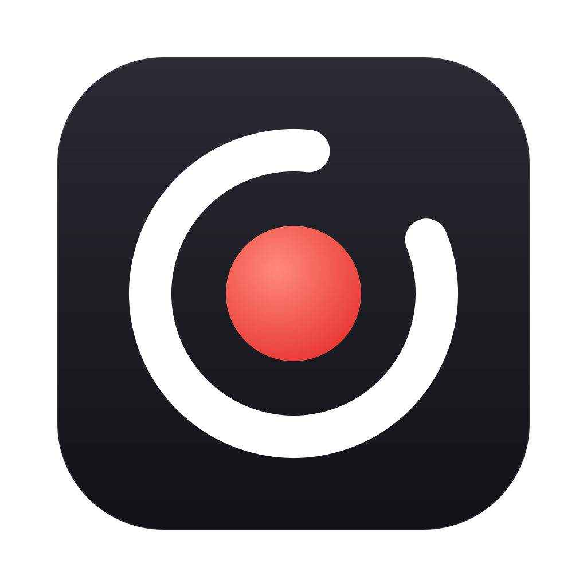
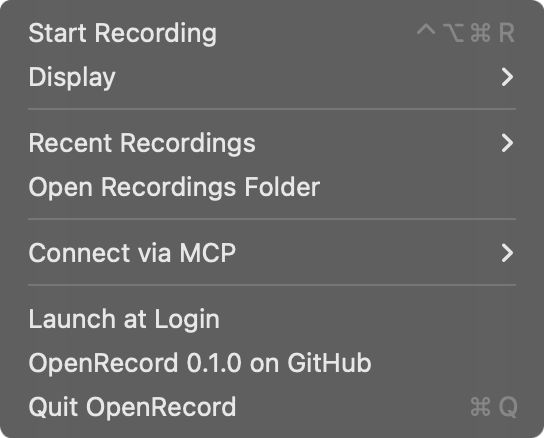

<p align="center">
  
</p>

<h1 align="center">OpenRecord</h1>

<p align="center">
  Record your screen while you talk. Transcribed on your Mac. Readable by AI agents over MCP.
</p>

<p align="center">
  <a href="https://github.com/dorukgunes/openrecord/actions/workflows/ci.yml"></a>
  <a href="LICENSE"></a>
  
  
</p>

<p align="center">
  
</p>

OpenRecord is a small, local, open-source take on [Supercut](https://supercut.ai) and Loom for macOS. Explain a bug,
walk through a design, or narrate a demo. Then ask your coding agent to *watch* it: OpenRecord's MCP server gives
Claude Code, Cursor, Codex and other MCP clients your transcript, a search across everything you've said, and
screenshots from any moment of the recording.

No account, no cloud, no upload. Recordings and transcripts stay in `~/Movies/OpenRecord`.

## Features

- **One-key recording**: press **⌃⌥⌘R** anywhere, or use the menu bar, to record a whole display plus your microphone
  into a single MP4.
- **On-device transcription** with [whisper.cpp](https://github.com/ggml-org/whisper.cpp)
  (`large-v3-turbo`, Metal-accelerated), with voice-activity detection so silence doesn't turn into invented text. The
  language is detected automatically, and every segment is timestamped.
- **Built-in MCP server**: five read-only tools to list recordings, read transcripts, search what you said, and pull
  frames at any timestamp.
- **Small by design**: a menu bar app (no Dock icon). No webcam bubble, editor, or share links.

## Requirements

- macOS 15 Sequoia or later, Apple silicon (Intel Macs are untested)
- Xcode 26.1 or later (Swift 6.2) to build
- [Homebrew](https://brew.sh), for whisper.cpp

## Install

OpenRecord is source-only for now. Building takes about a minute:

```sh
git clone https://github.com/dorukgunes/openrecord.git
cd openrecord
make whisper     # brew install whisper-cpp, then download the models (~575 MB)
make install     # build OpenRecord.app and copy it to /Applications
open /Applications/OpenRecord.app
```

`make app` builds into `build/OpenRecord.app` instead if you'd rather not install it.

> **Signing:** macOS ties Screen Recording and Microphone grants to the app's code signature. `make app` signs with
> your Developer ID or Apple Development certificate when you have one, so the grants survive rebuilds. Without a
> certificate it falls back to an ad-hoc signature, and you'll re-grant access after each rebuild. To pick a specific
> identity, set `CODESIGN_IDENTITY="..."`.

### First recording and permissions

The first time you record, macOS asks for two permissions:

| Permission | Why | Where to change it |
| --- | --- | --- |
| Microphone | Your narration | System Settings › Privacy & Security › Microphone |
| Screen Recording | Capturing the display | System Settings › Privacy & Security › Screen & System Audio Recording |

macOS may ask you to reopen OpenRecord after you allow Screen Recording. The global hotkey uses Carbon's
`RegisterEventHotKey`, so OpenRecord does **not** need Accessibility access.

About once a month, macOS 15 also asks whether OpenRecord may *bypass the system private window picker and directly
access your screen and audio*. Choose **Allow**. macOS asks this of every app that records a screen picked in the app
instead of in Apple's picker. Despite the wording, OpenRecord never records system audio, only your microphone.

## Recording

1. Press **⌃⌥⌘R**, or open the ◉ menu bar icon and choose **Start Recording**. Choose which screen to record under
   **Display**.
2. Talk through what you're doing. The menu bar shows the elapsed time.
3. Press **⌃⌥⌘R** again to stop. OpenRecord saves the video and transcribes it in the background. A few seconds
   later, **Recent Recordings** shows it as *transcribed*.

Each recording is one folder:

```
~/Movies/OpenRecord/2026-11-04_22-09-48/
├── recording.mp4      # H.264 (HEVC above 4096 px), display + microphone, 30 fps
├── meta.json          # title, date, duration, resolution, microphone, transcript status
└── transcript.json    # {language, segments: [{start, end, text}]}, times in seconds
```

To delete a recording, delete its folder.

## Connect your agent (MCP)

The server is the `openrecord-mcp` binary inside the app. The **Connect via MCP** menu item copies the Claude Code
command or a JSON config with the right path filled in. The snippets below assume the app is in `/Applications`.

<details open>
<summary><b>Claude Code</b></summary>

```sh
claude mcp add --scope user openrecord -- /Applications/OpenRecord.app/Contents/MacOS/openrecord-mcp
```
</details>

<details>
<summary><b>Claude Desktop</b></summary>

Add to `~/Library/Application Support/Claude/claude_desktop_config.json`:

```json
{
  "mcpServers": {
    "openrecord": { "command": "/Applications/OpenRecord.app/Contents/MacOS/openrecord-mcp" }
  }
}
```
</details>

<details>
<summary><b>Cursor</b></summary>

Add to `~/.cursor/mcp.json`:

```json
{
  "mcpServers": {
    "openrecord": { "command": "/Applications/OpenRecord.app/Contents/MacOS/openrecord-mcp" }
  }
}
```
</details>

<details>
<summary><b>VS Code</b></summary>

Add to `.vscode/mcp.json` (or run **MCP: Add Server** and choose *Command (stdio)*):

```json
{
  "servers": {
    "openrecord": { "type": "stdio", "command": "/Applications/OpenRecord.app/Contents/MacOS/openrecord-mcp" }
  }
}
```
</details>

<details>
<summary><b>Codex CLI</b></summary>

Add to `~/.codex/config.toml`:

```toml
[mcp_servers.openrecord]
command = "/Applications/OpenRecord.app/Contents/MacOS/openrecord-mcp"
```
</details>

### Tools

| Tool | Arguments | Returns |
| --- | --- | --- |
| `list_recordings` | `limit` (default 20) | Newest first, with duration, transcript status and a preview of what you said |
| `get_recording` | `id` | Metadata and the local video path |
| `get_transcript` | `id`, `start_seconds`, `end_seconds` | One `[m:ss] text` line per segment |
| `search_recordings` | `query`, `limit` | Moments where you said every word, ignoring case and accents, across all recordings |
| `get_frames` | `id`, `timestamps` or `count` (default 4), `max_width` (default 1024) | Up to 10 JPEG screenshots |

Every `id` also accepts `"latest"`. All tools are read-only and idempotent, and they never touch the network.

### Things to ask

- *"Watch my latest OpenRecord recording and fix the bug I describe."*
- *"Find where I talked about the invoice total and show me the screen at that moment."*
- *"Turn yesterday's walkthrough into a Linear ticket with repro steps and screenshots."*
- *"Summarize my last three recordings."*

## Privacy and security

- **Local only.** The app and the MCP server make no network requests. Only `make whisper` goes online, to install
  whisper.cpp from Homebrew and download models from Hugging Face.
- **What leaves your Mac is up to you.** When your agent calls a tool, the transcript or frames it gets go to that
  agent's model provider, as with any other context you give it.
- **Treat recordings as untrusted input.** Anything on screen or said aloud ends up in transcripts and frames. That
  includes text written to manipulate an AI (prompt injection). The server tells clients to treat this content as
  data, but keep approval prompts on for tools that can act, such as shell commands, writes or web requests.
- **Stored unencrypted** in `~/Movies/OpenRecord`, like any other video. FileVault protects it at rest.
- Recording ids from MCP clients are checked against an allowlist, so tools can't read outside the recordings folder.

Report vulnerabilities privately; see [SECURITY.md](SECURITY.md).

## Troubleshooting

<details>
<summary><b>Recording won't start, or says it needs Screen Recording permission</b></summary>

Choose **Open Privacy Settings…** in the menu and turn OpenRecord on. If it's already on, which can happen after a
rebuild or update changed the signature, reset the grant and relaunch:

```sh
tccutil reset ScreenCapture io.github.dorukgunes.openrecord
tccutil reset Microphone io.github.dorukgunes.openrecord
```
</details>

<details>
<summary><b>"Transcription is off" in the menu</b></summary>

whisper.cpp or its model is missing. Choose **Set Up Transcription…**, or run `make whisper`, then **Check Again**.
Recordings made in the meantime are transcribed the next time OpenRecord launches. You can also choose **Transcribe
Again** on a recording under **Recent Recordings**.
</details>

<details>
<summary><b>⌃⌥⌘R does nothing</b></summary>

Another app probably owns the shortcut. Check the log for `Couldn't register ⌃⌥⌘R`:

```sh
log show --last 10m --info --predicate 'subsystem == "io.github.dorukgunes.openrecord"'
```
</details>

<details>
<summary><b>My agent sees no recordings</b></summary>

The MCP server reads the same `~/Movies/OpenRecord` folder as the app. If you set `OPENRECORD_LIBRARY` for one, set
it for both. To see exactly what an agent would get, run `make smoke`, which talks to the server over stdio.
</details>

## Configuration

| Environment variable | Default | Used by |
| --- | --- | --- |
| `OPENRECORD_LIBRARY` | `~/Movies/OpenRecord` | app and MCP server |
| `OPENRECORD_WHISPER_CLI` | `whisper-cli` from Homebrew or `PATH` | app |
| `OPENRECORD_WHISPER_MODEL` | `~/Library/Application Support/OpenRecord/models/ggml-large-v3-turbo-q5_0.bin` | app |

## FAQ

**Why a separate whisper.cpp install instead of bundling it?** The app stays under 7 MB, and Homebrew keeps
whisper.cpp updated and Metal-optimized. You can point `OPENRECORD_WHISPER_MODEL` at a smaller or larger model.

**System audio, webcam, single windows?** Not yet. The scope is deliberately narrow: you, talking over one display.
Open an issue if you need more.

**Why isn't it sandboxed or on the App Store?** It runs `whisper-cli` as a separate process, and its MCP server is
launched by other apps. Both are awkward inside the App Sandbox.

## How it works

```
┌──────────────── OpenRecord.app ────────────────┐        ┌───────────── your agent ─────────────┐
│ menu bar UI ─ ScreenCaptureKit ─► recording.mp4 │        │ Claude Code / Cursor / Codex / …     │
│                 whisper-cli ───► transcript.json│        │                                      │
│ openrecord-mcp ◄── reads ~/Movies/OpenRecord ───┼─stdio──┤ list / transcript / search / frames  │
└─────────────────────────────────────────────────┘        └──────────────────────────────────────┘
```

| Module | Role |
| --- | --- |
| `OpenRecordCore` | Recording library on disk, ScreenCaptureKit recorder, whisper.cpp transcription, frame extraction, search |
| `OpenRecord` | SwiftUI menu bar app and global hotkey |
| `OpenRecordMCPServer` / `openrecord-mcp` | MCP tools over stdio, built on the [MCP Swift SDK](https://github.com/modelcontextprotocol/swift-sdk) |

## Contributing

Bug reports, ideas and PRs are welcome. [CONTRIBUTING.md](CONTRIBUTING.md) covers building, the test suites (including
the ones that record your real screen), and the release process.

## License

[MIT](LICENSE) © 2026 Doruk Güneş
